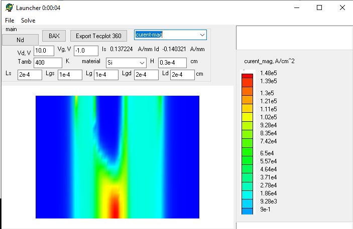

Основано на ДДМ модели. 
Для потенциала используется fft DCT-I (по горизонтали) и прогонка по вертикали (плюс
особый патч от Нейросети для правильного задания однородного Неймана между контактами).

Сетка 65 по горизонтали, на 20 по вертикали. Это demo приложение. 
Для решения используется segregated solver.

Язык С++, среда Visual Studio 2019 community. 
Операционная система Win 10 x64. 

Также результаты дублируются в TecPLot360. Можно его использовать для постпроцессинга.

Это бета версия. Приложение не имеет статуса релиза. Используйте на свой страх и риск.

